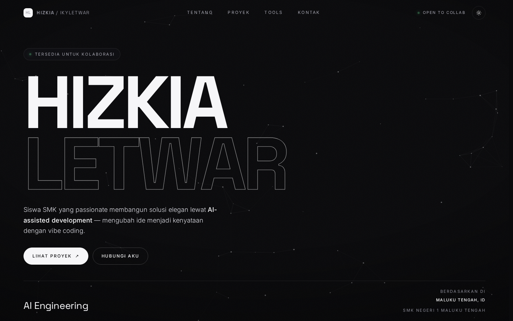

# Hizkia Letwar — Portfolio

Portfolio pribadi **Hizkia Letwar** ([@Ikyletwar](https://github.com/Ikyletwar)) — siswa TJKT SMK Negeri 1 Maluku Tengah, Vibe Coder & OSIS Bidang IT.

Dibangun murni dengan **HTML + CSS + JavaScript vanilla**: tanpa framework, tanpa build step, tanpa dependensi runtime. Cukup buka filenya di browser.

> **Elegance Is My Philosophy** — UI yang bersih, fungsi yang elegan, fitur yang thoughtful.



---

## Fitur

| Kategori | Detail |
|---|---|
| **Kinetic typography** | Nama dipecah per huruf, dianimasikan dengan stagger; baris kedua memakai gaya outline |
| **Animasi premium** | Quote *"Elegance Is My Philosophy"* dengan reveal fokus‑dari‑blur + gelombang kilau berkala |
| **Dua tema** | Gelap & terang, mengikuti `prefers-color-scheme`, tersimpan di `localStorage`, tanpa flash saat load |
| **Latar canvas** | Jaringan partikel monokrom yang merespons kursor |
| **Navigasi** | Bar glass dengan *backdrop blur*, *scroll‑spy* penanda section aktif, menu hamburger di mobile |
| **Mikro‑interaksi** | Kursor kustom, spotlight mengikuti kursor di kartu, tombol dengan animasi isi, back‑to‑top |
| **Salin email** | Tombol salin ke clipboard (Clipboard API + fallback) dengan notifikasi toast |
| **Daftar repo** | 10 repositori GitHub terbaru, diambil manual dan ditautkan langsung |

## Aksesibilitas & praktik terbaik

- Kontras teks memenuhi **WCAG AA** (judul ~18:1, body ~13:1, teks sekunder ~7,4:1, label kecil ~5,3:1).
- Struktur semantik: `header`, `nav`, `main`, `section`, `article`, `figure`, `dl`, `footer`.
- `skip link`, `:focus-visible`, `aria-label` / `aria-expanded` / `aria-current`, alt text pada gambar.
- Menghormati **`prefers-reduced-motion`** — seluruh animasi dinonaktifkan.
- **Berfungsi tanpa JavaScript**: konten tetap tampil (HTML statis), hanya animasi yang hilang.
- SEO & sosial: meta description, Open Graph, Twitter Card, dan **JSON‑LD `Person`**.
- Gambar memakai `width`/`height` (anti‑layout shift) dan `loading="lazy"`.

## Teknologi

- HTML5 semantik
- CSS3 — custom properties, `clamp()`, grid, flexbox, `color-mix()`, media query
- JavaScript vanilla — IntersectionObserver, Canvas 2D, Clipboard API, `localStorage`
- Google Fonts: **Space Grotesk** (display) & **Inter** (body)

Tidak ada `npm install`, tidak ada bundler.

## Struktur

```
.
├── index.html          # seluruh situs: markup + CSS + JS dalam satu file
├── assets/
│   ├── profile.jpg     # potret
│   └── preview.png     # gambar preview untuk README
└── README.md
```

## Menjalankan secara lokal

Buka langsung:

```bash
xdg-open index.html
```

Atau lewat server lokal (disarankan agar semua fitur berjalan konsisten):

```bash
python3 -m http.server 8000
# lalu buka http://localhost:8000
```

## Kustomisasi

Semua yang sering diubah terkumpul di satu tempat.

**1. Teks rotator & marquee** — objek `CONFIG` di dalam `<script>`:

```js
const CONFIG = {
  roles: ["Vibe Coder", "OSIS Bidang IT", "AI Engineering", "UI Design Enthusiast"],
  marquee: ["Vibe Coding", "AI Engineering", "Trae AI", "Qwen Code CLI", "UI Design", "Elegance", "OSIS IT"]
};
```

**2. Konten** — ditulis langsung sebagai HTML statis di dalam `<main>` (section `#about`, `#work`, `#tools`, `#inspirasi`, `#contact`), jadi mudah disunting dan tetap terbaca mesin pencari.

**3. Warna & tema** — token di bagian atas CSS:

```css
:root{ --bg:#0a0a0c; --fg:#f6f6f8; --text:#dcdce3; /* tema gelap */ }
[data-theme="light"]{ --bg:#f3f3f0; --fg:#0b0b0d; /* tema terang */ }
```

**4. Foto profil** — ganti `assets/profile.jpg` (disarankan rasio 1:1; dipotong bulat otomatis).

**5. Tema default** — di `<head>`, ubah baris ini agar selalu gelap:

```js
var t = saved || "dark";
```

## Deploy ke GitHub Pages

1. Push repo ini ke GitHub.
2. Buka **Settings → Pages**.
3. Pada **Source**, pilih branch `main` dan folder `/ (root)`.
4. Simpan — situs akan tersedia di `https://<username>.github.io/<nama-repo>/`.

## Kontak

- Email — [manggadurian20@gmail.com](mailto:manggadurian20@gmail.com)
- GitHub — [@Ikyletwar](https://github.com/Ikyletwar)
- TikTok — [@ikyletwar](https://www.tiktok.com/@ikyletwar)
- Instagram — [@ikyletwar](https://www.instagram.com/ikyletwar/)

---

Dirancang dan dibangun oleh **Hizkia Letwar**. Elegance Is My Philosophy.
